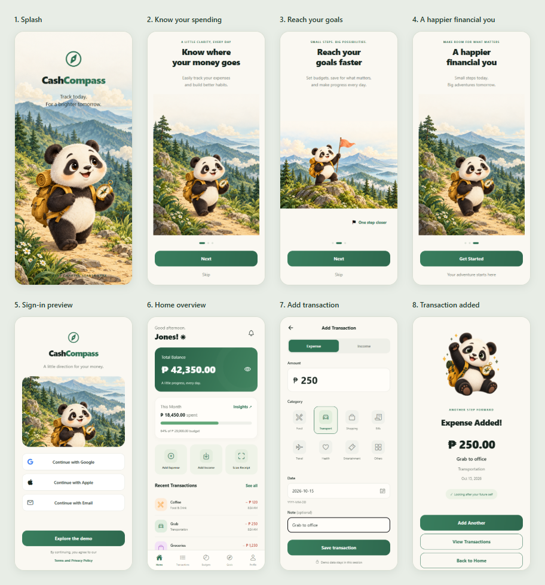
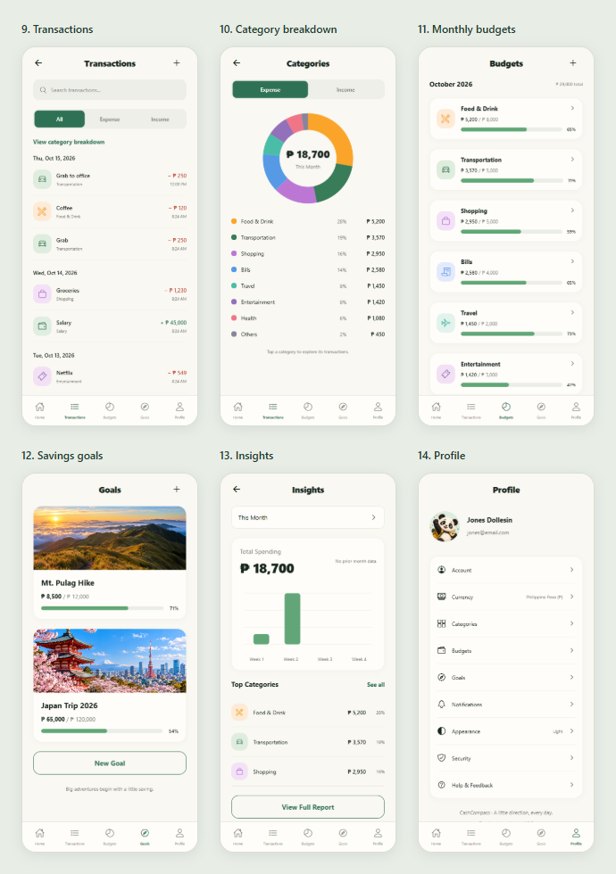

# CashCompass

**Track today. For a brighter tomorrow.**

CashCompass is a mobile-first personal finance app concept for everyday money management in the Philippines. Record expenses and income, understand spending, plan monthly budgets, and save toward your next adventure—with Panda Pocket, a friendly panda explorer, along the way.

This repository contains an interactive **React Native frontend preview** of the fourteen-screen storyboard. It uses Philippine pesos, a cream and forest-green palette, rounded cards, and custom panda illustrations. The web preview stays phone-width so you can review the mobile experience on a desktop.

> Demo data lives in memory and resets when the app reloads. No account, bank connection, or backend is required.

## Screenshots

Actual app captures from the production **web preview at 390 × 844**, taken on October 15, 2026. These show the implemented UI; native Android and iOS rendering may differ.

### Welcome and daily tracking



### Planning and insights



The gallery follows one demo journey: a ₱250 transportation expense is saved after the Home capture, so the later screens show ₱18,700 in monthly spending. [Full-resolution screenshots and capture instructions](screenshots/README.md).

## What you can explore

| Area | Implemented behavior |
| --- | --- |
| Welcome | Illustrated splash, three onboarding slides, next/skip controls, and replay from Profile |
| Sign-in preview | Google, Apple, and email options explain the preview; **Explore the demo** opens Home |
| Home | Balance visibility toggle, monthly spending progress, recent activity, and expense/income shortcuts |
| Transactions | Add, search, filter, view details, edit, and confirm deletion of expenses and income |
| Categories | Expense/income donut chart, category totals and percentages, and links to filtered transactions |
| Budgets | Editable monthly category limits, utilization bars, and over-budget amounts |
| Savings goals | Illustrated goal cards, create-goal form, and contribution tracking |
| Insights | Month selector, weekly spending bars, top categories, and a monthly summary report |
| Profile | Editable demo name/email, navigation shortcuts, and settings previews |

Transactions, balance, category totals, budgets, and insights share the same state. Goal contributions record savings already set aside; they do not count as spending or transfer money.

## Getting started

### Requirements

- Node.js **22.13 or newer** (this project was initialized with Node 22.14).
- npm, included with Node.js.
- Chrome or Edge for the web preview; a compatible Expo Go installation or native development environment for device testing.

### Install and run

From the repository root:

```powershell
npm ci
npx expo start --web --clear
```

Open the local URL printed by Expo. In Chrome or Edge, press **F12**, then **Ctrl+Shift+M**, and choose a phone preset. A **390 × 844** viewport is a useful starting point. The app is capped at 460px on larger browser windows and fills the available width on phones.

To start the native preview instead:

```powershell
npx expo start
```

Open the QR code with a compatible Expo Go app, or press **a** with an Android emulator configured. The local iOS simulator requires macOS. Browser previews help review layout; native device behavior still needs separate testing.

If Metro becomes unresponsive, stop it with **Ctrl+C**, restart with `npx expo start --web --clear`, then refresh the browser.

### A quick walkthrough

1. Complete or skip onboarding, then select **Explore the demo**.
2. From Home, choose **Add Expense**, enter an amount, select a category and date, and save.
3. Open **View Transactions** on the confirmation screen; tap an entry to edit or delete it.
4. Visit **Budgets** to change a monthly limit, then check the updated spending progress.
5. Open **Goals** to create a savings target or record a contribution.
6. Choose **Insights** from Home to explore the monthly summary.

## Technology and structure

- Expo SDK 57, React 19, React Native 0.86, and TypeScript.
- Expo Router for screen navigation.
- React Native StyleSheet for styling; NativeWind is not installed.
- React context for session state, React Native SVG for charts, Expo vector icons, and Expo LinearGradient.

```text
src/
  app/          Expo Router screens and root layout
  components/   Shared controls, navigation, finance UI, and charts
  screens/      Shared splash and onboarding implementations
  state/        Demo transactions, budgets, goals, and profile state
assets/         App assets, illustrations, and goal covers
docs/           Original product handover and design storyboard
```

The five main tabs are **Home**, **Transactions**, **Budgets**, **Goals**, and **Profile**. Category breakdown is accessible from Transactions; Insights is accessible from Home.

## Current scope

| Available in this preview | Not connected yet |
| --- | --- |
| In-session transaction and budget updates | Persistent storage and backend synchronization |
| Demo profile editing | Account creation and provider authentication |
| Manual transaction entry | Receipt scanning and bank/wallet integrations |
| Notification preference controls | Device notification scheduling |
| PHP amounts and the light theme | Currency conversion and dark mode |
| Security information | Biometric authentication |

The UI identifies these preview boundaries. Use sample data while exploring; the app is not a production financial service.

## Development checks

```powershell
npx tsc --noEmit
npx expo lint
```

To verify the JavaScript bundles for all platforms:

```powershell
npx expo export --platform all --no-bytecode --max-workers 2
```

The no-bytecode option is a diagnostic workaround for a Windows Hermes compiler crash encountered during implementation. It does not verify native release compilation and should not be treated as a production build recommendation.

Browser verification covers the fourteen-screen journey and confirms that adding, editing, and deleting an expense updates the balance. The capture script also checks for uncaught browser exceptions. These checks do not replace native-device testing.

Dependency installation reported 28 npm audit findings (10 moderate, 18 high). Run `npm audit` to review the current dependency report; these findings have not been remediated in the frontend milestone.

## Design references and assets

- [Product and UX handover](docs/design/CASHCOMPASS_PRODUCT_UX.md)
- [Original fourteen-screen concept storyboard](docs/CashCompass%20App%20Flow%20Storyboard.png)
- [Generated illustration assets and prompts](assets/GENERATED_ASSETS.md)

The storyboard is a design reference. Generated illustrations are new interpretations of its visual direction. **CashCompass** is the product; **Panda Pocket** is the mascot. The original design documents are preserved.
